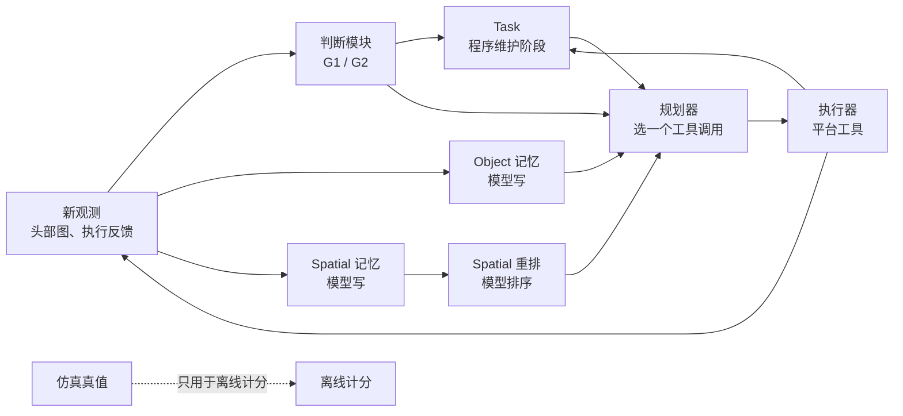

# 整套设计的现状（1102）

**用途**：用户要从顶层重新设计整套东西（1102："把完整的设计给我列一下，我觉得我们要从顶层重新设计一下整套东西"）。这里把到 1102 为止的设计逐层列出来。

**怎么读**：
- 每一项写三样：它是什么，从哪个决定来，证据说明了什么。
- 第九节是已经暴露出来的问题，只写事实。
- 第十节是重新设计要回答的问题，不带答案。按惯例，顶层的草稿由用户先写。

## 一、研究层

| 项 | 现在的说法 | 来源 |
|---|---|---|
| 研究问题 | 长程具身任务里，上下文对规划决策值多少、价值从哪来、我们生成的记忆兑现了多少。兑现分三段：写下来、送到规划器、被用上 | 1027 改写 |
| 论文线 | 上下文该留什么；怎样送到每次决策；什么时候该重新看，而不是相信记忆 | 1023 |
| 最终目标 | 优化上下文，让小模型也能做出好的规划，所以规划器不开推理 | 用户 1031 |
| 指引 | 可以算上下文，但不能手写启发式，要找产生它的办法 | 用户 1031 |
| 身体信息 | 让规划器"把身体当工具用"：走近、调躯干和手臂去确认、摆好预抓取姿势；量到"准备好抓取"为止，之后假设抓取一定成功 | 1030 |
| 操作 | 可以用语义化的开、关、拿、放工具，不用 VLA，不做运动规划 | 1029 |
| 强任务 | 借鉴 EMem-Bench 的思路；历史由智能体自己探索产生 | 1029（还没做出来） |

**用户自己的两条想法**（`几个想法.md`）：
- **主线一，可修订的决策充分上下文**：摘要"现在够用"，以后有新证据时，可能没法正确纠错。要在预算内留下"修订所需的最小依据"。
- **主线二，面向未来可观测性的记忆和行动协同**：行动会改变以后还能拿到什么信息。可以按"最后一次低成本取证的机会"来安排记忆。

**用户 1031 的看法**：身体信息像一个新的东西；RoboCasa 介于 THOR 和 BEHAVIOR 之间，适合做主实验；"有价值的信息为什么没兑现"值得挖。

**外部意见**（Gemini 1031 宏观评估，`会审/1031-Gemini宏观评估.md`）：
- 现在的问法更像"体检账单"，不是论文的命题；
- 还没有一组干净的"有记忆 vs 没记忆"结果；
- 六条线里只有一条半在回答主线。

**1102 的决定**：重心放到 RoboCasa，先把闭环跑通。

**现状**：还没有论文级的结论，也还没有一组"有记忆、没记忆、参考记忆"的干净对比。

## 二、系统层：每一步发生什么

- **每步大约 5 次模型调用**：判断、Object、Spatial、Spatial 重排、规划器。判断模块说看到了目标时，还要多一次位置复核。Experience 关着。
- **模型**：都是 deepseek-flash，温度 0，不开思考，JSON 输出。服务端版本没法固定，每次调用都记下来。

| 角色 | 做什么 | 看得到 | 看不到 |
|---|---|---|---|
| 规划器 | 每步选一个工具调用；读记忆，不写记忆；不判断找没找到，也不能结束任务 | Task 块（目标、阶段、剩余决策数、G1/G2）；当前观测和图；上一步的观测；最近 3 次动作和实际结果；上一步自己写的小目标；Object 和 Spatial 各最多 4 条；工具表；图片有 CURRENT、BEFORE，还可能有一张 HISTORICAL | 仿真真值、分数 |
| 判断模块 | 判 G1：目标在任意一张当前头部图里，含 scan 的图；判 G2：目标在正对方向那张图里。整图加 2×2 切块，看到了还要做位置复核 | 动作前后的图、条件、执行反馈 | 规划器的理由、记忆、任务叙述 |
| Object | 一条记录写一个关于物体的判断：依据是观测还是推断、来源图、同一个还是新的 | 当前和上一张图、目标名、自己的旧记录和原图 | 规划器的理由、别的记忆、判断结果 |
| Spatial | 写布局、区域、地标，带相机位姿和里程计 | 图、位姿、自己的旧记录和原图 | 任务、目标、规划器的理由、别的记忆 |
| Spatial 重排 | 按当前目标给 Spatial 条目排序 | 目标、任务、条目 | — |
| Experience | 记"什么情况、怎么做、效果如何"的案例 | — | v2 里关着 |
| Task | 程序维护：目标、阶段、每阶段的决策预算、完成情况 | — | — |
| 程序视点索引 | 记下走过的视点，作为 Spatial 的"程序条目"，还用来挑 HISTORICAL 图 | — | — |

**给规划器的检索顺序**：Object 里写到当前目标的排在前面，其余按新旧；Spatial 按重排的结果，重排失败就按新旧。

**规划器的系统提示**（v2，1029 冻结）：
- **开头**："a mobile robot that searches indoor scenes for target objects"。
- **分工**：规划器只选工具；判断模块报 G1/G2；记忆由别的模块写；程序在 G2 满足时完成阶段。
- **任务和完成**：只有 G2 满足才算完成阶段；只在 scan 图里看到不算。
- **证据**：分清现在看到的、记忆里的、推断的、预期的。
- **做法**：五条，都在讲找东西。比较预期；看得见目标就转到正前方；否则选最可能看到目标的动作；重复看没新东西就换方向；永远不说"这里找遍了"。
- **身体**：平台填空，包括机器人、相机、视场、怎么动、位置怎么来、哪些做不到。
- **输入**：逐项说明用户消息里的 JSON。
- **输出**：reason（第一句先说 G1、G2 的状态）、subgoal、tool、arguments、expected_outcome。

**冻结的规矩**（1029）：
- 冻结以后只修会让数据作废的错误；
- 扩展要满足两条：没开扩展的现有任务，规划器输入逐字节不变；扩展单独做在线检查。

**硬约束**（`AGENTS.md`，改之前要先讨论）：
- 四类记忆各自独立，只共享原始证据；
- 仿真真值和分数不进任何模型输入。

## 三、动作层：工具

| 工具 | BEHAVIOR | THOR | RoboCasa |
|---|---|---|---|
| observe、rotate_base、move_base、request_help | 有 | 有 | 有 |
| scan | 有 | 5 张，每 72° 一张 | 没有 |
| move_to_point | 先转向再直行，上限 1.5 m，身前留 0.4 m | 沿网格走到离点最近的可达位置，上限 1.5 m | 保持朝向平移，不留距离，没有上限 |
| open、close、pick_up、put | 没有 | 有，按点到的实例像素找物体 | 有，按点到的像素找物体；拿起后不抬 |
| set_torso、wrist_view | 没有 | 没有 | 有 |

- **安全**：BEHAVIOR 有全身防护；RoboCasa 按车身扫过的真实几何查碰撞，碰到就停，不绕路。
- **已做好、还没进规划器工具表的**：回视点工具（5 套住宅都能准确走回原视点）；跨房间导航（ProcTHOR 5 套住宅、10 处房间连接走通）。
- **定了、还没做的**：开、关、拿、放改成"点 + 名字"（1031 定，原定 THOR 下一轮做）。
- **只在实验里加过的**：
  - 身体信息字段（BEHAVIOR）：body_state（被挡的方向和距离）、failure_history（连续被挡几次）、blocked_episode（这一段卡住的经过）；
  - 新输出格式 v3（THOR 试点）：stage_status、last_step_check、evidence、why、tool、arguments、expected_change。

## 四、任务层

**阶段的写法**：
- **找东西**：A→B→A，判断模块报 G2 才算完成。
- **搬东西**：THOR 单住宅试点里加的，按公开的工具反馈推进：拿成功、放成功，开过的还要关成功。
  - 共享提示没改，仍然写着"只有 G2 满足才算完成"，搬东西的要求只写在这一阶段的任务文字里。
- **预算**：每个阶段有固定的决策预算，用完就进下一阶段。

**用过的任务**：

| 平台 | 任务 | 时间 |
|---|---|---|
| BEHAVIOR | make_pizza 场景里找刀 | 1020–1022 |
| BEHAVIOR | A→B→A 找东西，v2 在线检查，起点 8、13、108、127、138 | 1029 |
| BEHAVIOR | 卡住：起点 108（目标在餐桌后面）、13（开局受阻）、8（不会卡住） | 1030–1031 |
| THOR | v2 在线检查，FloorPlan1、3、9、11、15 | 1029 |
| THOR | 单住宅四阶段（FloorPlan1）：被动观察、自己挪过、容器线索，每阶段 7 次决策 | 1029–1030 |
| THOR | 在线 v2 对 v3：自己挪过、容器线索两类搬运，各 8 对 | 1031 |
| RoboCasa | 两个官方环境 × 3 个布局，找苹果 | 1030–1031 |

**还没有的**：必要的事实只在记忆里的任务。

## 五、评估层

- **在线完成**：找东西看 G2；搬东西看公开的工具反馈。
- **离线核对**：只用仿真真值，记误完成：
  - BEHAVIOR：A5 记录每张图里物体的真实像素和框；
  - THOR：物体位置和状态；
  - RoboCasa：官方的 `_check_success()`。
- **三段兑现**：
  - 写下来：记录里有没有；
  - 送到：规划器输入里有没有；
  - 用上：理由里有没有引用。引用不等于因果。
- **流程**：
  - 开跑前定读法线、写预测；
  - 先给原始结果，再写读法。
- **别的量**：用了几次决策、重复失败的串数、宽和严两种口径（卡住实验）、首答格式不合格、token 和用时。
- **噪声**：温度 0 也不稳定，服务端 1028 换过版本。所以和同一批的对照交错着问，每个点重复 5 次以上。

## 六、平台层

| 平台 | 机器人 | 每次决策 | 操作 | 现在的角色 |
|---|---|---|---|---|
| BEHAVIOR-1K | R1Pro，真实本体 | 约 28 秒，物理驱动 | 只有移动 | 做验证；这段时间暂停 |
| AI2-THOR | 没有机器人本体 | 约 8–10 秒 | 语义工具 | 还没定；这段时间暂停 |
| RoboCasa365 | PandaOmron，轮式底盘、升降躯干、七轴手臂 | 约 8.5 秒 | 运动学的语义工具 | 1102 起是主平台 |

## 七、实验线和现状（到 1102）

| 线 | 问的问题 | 平台 | 结果 |
|---|---|---|---|
| 身体信息与卡住 | 告诉规划器身体的状态，能不能少卡住 | BEHAVIOR | 能让规划器换动作，浅的卡住更快脱困；目标在餐桌后面时仍然卡住。严格口径下，往空地走：开思考 7/25，开思考加指引 11/25；生成的事实认得准（障碍 25/25、空地点 75/75），送回不开思考的规划器，最好的一组 6/25 |
| 规划器输出格式 | 先核对上一步、写依据和预期，再出动作，会不会更好 | BEHAVIOR 离线、THOR 在线 | 离线两轮没看到改善；THOR 在线搬东西，原格式 4/16，新格式 1/16 |
| 感知兜底 | 训练专用识别模型，能不能补判断模块的错 | THOR | 关键类召回达标；空图误报 4.04% 和 3.28%、点位纠正 0/5，都没达标。读法等用户写 |
| 多阶段记忆试点 | 多阶段任务里，记忆有没有用上 | THOR | 单纯找东西的阶段全部完成；要先搬东西的阶段大多失败，6 次拿取失败里 5 次是点偏；记忆的作用读不出来 |
| RoboCasa | 能不能接成可用的平台 | RoboCasa | 移植四关都过了；只接了找苹果，找到 1/6。闭环说明第二稿还没发 |
| BEHAVIOR 提速 | 能不能更快 | BEHAVIOR | 拆开渲染后转身快 1.5–2 倍，但靠近障碍的平移结果会变，没有采用 |

**等用户写读法的**：THOR 在线 v2 对 v3、THOR 识别模型、RoboCasa 移植。

## 八、工作方式

**分工**：
- **用户**：定方向和关键决定。
- **Claude**：协调，写说明，核对结果，记笔记。
- **开发用的 Codex**（开发机上的 tmux 会话）：gpt 做 BEHAVIOR 和离线检查；gpt2 做 THOR；gpt3 做 RoboCasa。
- **顾问**：GPT 主要审稿；Gemini 查文献、唱反调。两者都只读。

**一轮怎么走**：
1. Claude 写说明草稿，要紧的先会审；
2. 用户同意；
3. 提交到仓库的 `docs/tasks/`，发给开发 GPT；
4. 开发 GPT 实现、做检查、跑、写报告；
5. Claude 核对；
6. 写原始结果；
7. 用户写读法；
8. 定下一步。

**规矩**：
- 顶层问题用户先写；原始结果先于读法；开跑前写预测；
- 一轮的范围定了不加项；检查从简；
- 工具先做到可用、冻结，再采基线；
- 源码、配置、文档进 Git，运行结果和权重不进，版本记在清单里。

**东西放在哪**：
- 代码仓库：共享分支 `codex/context-engineering-demo`，THOR `codex/thor-semantic-tools`，RoboCasa `codex/robocasa-port`；
- 运行结果在开发机上；
- 笔记在这个库里；
- 进展页：https://claude.ai/artifact/JsEu7GKtfVekatw9LxvDhw 。

## 九、已经暴露出来的问题（只写事实）

1. **系统是围着"找东西"设计的**：
   - 规划器提示开头就是"在室内找目标物体"，阶段完成只认 G2，"做法"五条都在讲搜索，reason 第一句要先报 G1、G2。
   - 搬东西是后来接上的：要求写在任务文字里，共享提示照旧说"只有 G2 满足才算完成"，两边对不上。身体信息也是外加的字段。
   - 用户 1031 说过："老围绕看没看到这个事情本身就是错的"。
2. **还没有一组干净的"有记忆、没记忆"对比**：多阶段试点里，记忆的作用读不出来。
3. **写对了、送到了，不开思考就用不上**：
   - 卡住时，生成的障碍和空地都认得准，送回不开思考的规划器，往空地走最多 6/25；
   - 开思考加指引是 11/25。
4. **搬东西的失败，大头出在接口上**：
   - THOR 单住宅试点 6 次拿取失败里，5 次是点偏；
   - THOR 在线试点，原格式拿取 10 次成功、15 次失败；
   - RoboCasa 拿起后物体不抬，除了升躯干，别的动作一开始就被判成碰撞。
5. **"同一个 v2"在三个平台上不一样**：move_to_point 有三种语义，scan 有的有、有的没有，指物方式也不同。
6. **系统很重，没和简单的做法比过**：每步约 5 次模型调用、输入的 JSON 很长，从来没和"最近几步滑动窗口"或"滚动摘要"这类简单做法比过。这一条是 Gemini 指出的。
7. **噪声大、样本小**：
   - 同样的输入，温度 0，两批之间会变，比如 b 类 10/18 变成 5/18；
   - 场景少，一个厨房、一张餐桌反复用。
8. **判断模块会认错**：比如把锅当成水壶、把书当成烤面包机。新目标类别 12 个里只过了 1 个。
9. **线多**：六条线并行；1030–1031 两天开了好几场会审。

## 十、重新设计要回答的问题（不带答案）

1. **研究问题和第一篇的说法**：在"上下文值多少的审计""身体信息""有价值的信息为什么没兑现"、主线一、主线二之间，第一篇选哪个，怎么说？
		肯定不是做审计，我们要看到效果。具体怎么选择这个先把闭环跑通再说
2. **系统以什么为中心**：找东西，还是长程任务的进度？阶段怎么定义，谁来判完成？
		重心一定是任务的完成，可以是robocasa本身定义的任务。不能继续围着找东西/搬东西这种自己定义的任务打转
3. **上下文放什么、按什么结构放**：世界的、身体的、任务进度的、经验的。四库分开要不要保留？改的话按 `AGENTS.md` 先讨论。
		世界、身体、任务、经验感觉都是有用的，具体的架构倒不一定非得是四个库这样子
4. **规划器**：用什么模型，开不开推理，输出写什么。
		可以找个对标的baseline工作，或者我们沿用目前的deepseek/qwen，也可以通过API调用一些闭源模型，看主流的工作是怎么做的好了
5. **动作接口**：语义工具多粗多细，怎么指物，哪些身体动作交给规划器。
		语义工具感觉可以仔细讨论一下
6. **任务**：什么任务能让必要的信息只在记忆里，历史怎么产生。
7. **评估**：主指标是什么；和什么比（没记忆、参考记忆、简单基线）；要多少样本；怎么处理噪声。
8. **平台**：RoboCasa 做主平台已定；THOR 和 BEHAVIOR 以后做什么。
		behavior可以作为上位的更真实版本做评估，thor到底还有没有用存疑
9. **工作方式**：哪些环节可以省，会审什么时候开。
		很多时候我先写预测这种可以省略掉，推进过程和测试验证的过程不需要。会审主要在一个阶段结束-下个阶段开始的时候做

## 十一、Claude 的意见（看了用户的草稿之后写，1102）

### 1. 顺着草稿往下展开

**草稿合起来是一句话**：让一个带上下文的规划器，在 RoboCasa 自己定义的任务上把任务做完，而且要做得比基线好。
- 上下文包括世界、身体、任务、经验，结构不一定是四个库；
- 规划器向主流工作看齐；
- BEHAVIOR 做更真实的评估。

**这意味着三处转变**：
1. **从"找到、搬到"转到"官方任务做完"**：
   - 完成与否看官方的 `_check_success()`，判断模块的 G1/G2 不再是中心；
   - 规划器提示要围着任务进度重写，现在的开头"在室内找目标物体"就不对了。
2. **从"审计"转到"看到效果"**：要有基线，要有我们改的那一部分，还要在同一个指标上比。改哪一部分，草稿说等闭环跑通再定。所以闭环要搭成上下文的各部分都能换掉的样子。
3. **从"四个库"转到"结构不定"**：`AGENTS.md` 写着四库独立、改之前先讨论。草稿打开了这个讨论，定下来以后要改 `AGENTS.md`。

### 2. 草稿要用到的几件事实（Claude 核对过）

- **RoboCasa365 的任务**：
  - 65 个原子任务，300 个组合任务；组合任务分 60 类，比如做三明治、洗碗、装冰箱、煮茶。
  - 原子任务按设施分：门、抽屉、拿放、水槽、炉灶、微波炉、烤箱、小烤箱、烤面包机、咖啡机、搅拌机、电水壶、厨师机，还有导航。
  - 也就是说，官方任务除了拿放，还要开关各种门和抽屉、拧旋钮、开水龙头、按电器的按钮。现在的 8 种工具只覆盖其中一小部分。
  - 官方评测用 50 个任务：18 个原子任务，16 个训练里见过的组合任务，16 个没见过的组合任务。
- **RoboCasa 的 agentic 榜**（10 月 28 日开放，规则见 [提交说明](https://github.com/robocasa-benchmark/leaderboard)）：
  - 接受在一个冻结的基础策略外面加一层新的智能体框架；
  - 基础策略不能改权重，只能用策略本来就有的观测，不能用仿真特权状态；回合中拿不到真值的成功信号；
  - 跨回合的记忆要申报；
  - 官方重跑那 50 个任务，以官方的数为准。闭源的规划器要交一个够跑完整评测的 API 额度。
- **最接近草稿的主流工作**：
  - **Harness VLA**（[arXiv 2607.08448](https://arxiv.org/abs/2607.08448)，v5，2026-09-24）：
    - 把冻结的 VLA 当作可以重试的接触操作原语，再配一小套固定的解析原语：定位、预备、搬运、导航、松手。
    - 记忆来自参考种子上的执行轨迹、通用的成功规则和失败模型，用来学会这些原语在什么范围内好用；不靠扩充技能库。
    - 在 RoboCasa365 上比最强的相关基线高 25.4 个百分点。
    - 规划器用的是 GPT-5.5、Opus-4.7、GPT-6 Astra。这一条出自检索摘要，没核对原文。
    - 官方代码是 RLinf/RPent。1019 读过，见 [[1019-下一轮实验方案-HarnessVLA-GPT]]。当时还查到，论文的规划器能看到基准给出的成功信号，按我们的规矩要藏起来。
  - **PhyAgentOS**（[arXiv 2607.16636](https://arxiv.org/abs/2607.16636)）：在基础策略外面加一层带校验的智能体。检索摘要说 π0.5 从 17.6% 升到 26.8%，没核对原文。
  - **ENPIRE**（NVIDIA）：编程智能体在 RoboCasa 里调 SAM3、抓取、运动规划和导航工具。工具没有公开。
  - **标准榜**：只有策略，第一名总分 64.4，没见过的组合任务 45.2%。这是 1030 核对的。

### 3. 草稿之后要先定的几个分叉（问题，不带答案）

**A. 底层的动作谁来做**。这是最大的分叉，它决定能和谁比，也决定身体信息还有没有位置：

| 做法 | 好处 | 代价 | 身体信息 |
|---|---|---|---|
| 甲：我们自己的运动学语义工具，也就是现在的 RoboCasa 移植 | 快、稳，问题集中在规划和上下文上 | 官方任务要补很多工具（旋钮、按钮、水龙头、各种电器门、抽屉）；执行器用了仿真特权信息，上不了 agentic 榜，和 Harness VLA 也不是一个比法 | 站位、躯干、手臂交给规划器，位置最大 |
| 乙：冻结的 VLA 当操作原语，也就是 agentic 榜和 Harness VLA 的做法 | 能直接和主流比，也能上榜 | 底层失败多；我们的贡献只能体现在调度和记忆上；要在开发机上跑 VLA；1029"不用 VLA"的决定要改 | VLA 自己处理身体；规划器能管的，主要是在哪里、什么时候调用它 |
| 丙：感知加运动规划的工具，也就是 ENPIRE、CaP-X 的做法 | 不用 VLA | 工程量最大；ASPIRE 实测抓取只有 1/3–2/3 | 介于甲、乙之间 |

**B. 谁来判任务做完了**：三种可能：
- 官方判定结束回合（规划器拿不到这个信号）；
- 规划器自己说完成，说早了算失败；
- 保留判断模块。

agentic 榜规定回合里拿不到真值的成功信号。

**C. 规划器和输出**：
- 主流用强的闭源模型，很多是编程智能体，一次写一段调用原语的程序，不是每步出一个 JSON 工具调用。
- 1031 定的"让小模型也能规划好、不开推理"，和"向主流看齐"不完全一致。哪个当主结果、哪个当补充，要定下来。

**D. "效果"指什么**：
- 指标：官方任务的成功率；
- 比较对象：同一个底层、同一个规划器；
- 改的东西：上下文的某一部分，世界、身体、任务进度、经验里选。

**E. 和 Harness VLA 的区别**：
- 它的记忆，主要是跨回合学到的"原语在什么情况下好用"，属于经验那一类。
- 我们可以放在回合之内：做到哪一步了、世界变成了什么样、身体现在能做什么。用户的主线一（可修订的上下文）、主线二（为以后还能看到什么做准备），还有"有价值的信息为什么没兑现"，都在这一边。这样它正好可以当基线框架，我们在上面换回合内的上下文。
- 如果我们也做跨回合的经验，就和它撞得更多。

### 4. 草稿里 Claude 认为有问题的地方

1. **"具体怎么选，先把闭环跑通再说"**：闭环怎么搭，取决于 A 和 B。如果先用甲搭好，以后要和 Harness VLA 比、或者上榜，底层就得重做。所以 A 要在跑闭环之前定，不能放到之后。
2. **用 RoboCasa 的官方任务**：
   - 走甲，工具层会膨胀得很快，因为官方任务要的设施操作远多于现有的 8 种；
   - 不管走哪条，都要先挑一个任务子集，比如官方评测那 50 个，或者其中技能能覆盖的一部分。
3. **第 6、7 问还空着**：
   - 第 6 问，任务改用官方的，就基本有了答案；
   - 第 7 问，"看到效果"要有对照设计和样本量。Harness VLA 每个条件跑 50 个任务、各 5 次，共 250 次。按这个量，闭源规划器的成本要先估。
4. **规划器**：沿用 deepseek、qwen，还是用闭源的，和 1031"小模型、不开推理"有冲突，要明确选一个当主结果。
5. **BEHAVIOR 做更真实的评估**：它上面用什么任务、什么动作接口，要和 RoboCasa 对得上，不然两边的结果比不了。
6. **THOR**：草稿说存疑。如果主线放在 RoboCasa 的官方任务上，THOR 剩下的用处不大。Claude 记得几个用高层动作的规划器基准是建在 THOR 上的，但这一条没核对。

### 5. 工作方式的两处改动，Claude 照办

- 推进和测试验证的过程，不再先写预测；
- 会审放在一个阶段结束、下一个阶段开始的时候。
